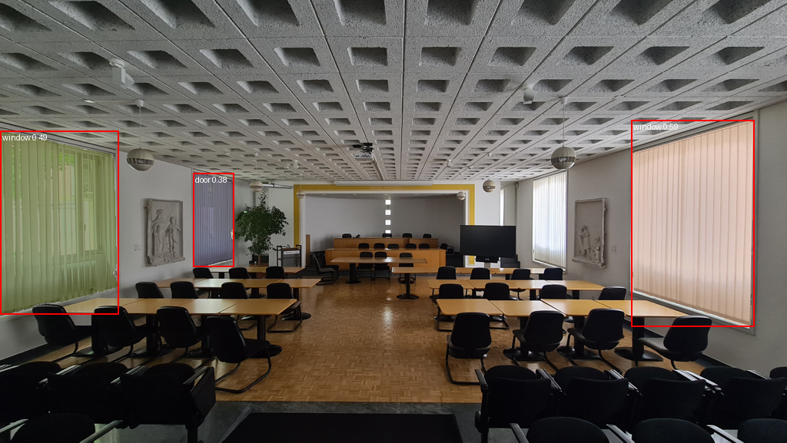

# TRACEABLE

## Repository layout

```text
vllm_pipeline/        Qwen-VL audit (vLLM.py), SUPSI rules/DB (supsi_kb_2.py), metric depth (estimate_metric.py), vllm_output/
sam_clip_pipeline/    Grounding DINO + SAM + CLIP package (main.py, cli.py, pipeline.py, ...)
scripts/              Helpers that generate reports and plots (make_report.py, make_detection_report.py, plot_bboxes.py)
reports/              Generated .docx/.xlsx reports, bbox_images/, output_of_SAM_doors_windows/
web/                  Floor-plan website (index.html, floor_plan_assets/), deployed by .github/workflows/pages.yml
01_Data/  models/   Survey photos (01_Data/Example of Inventory/Images/), reference data, model weights
```

Run every command from the repository root. `Depth-Anything-V2/` lives next to this repo.

TRACEABLE turns raw building-survey photographs into an engineering inventory
for circular construction assessment. The current workflow combines local
vision-language auditing, single-view metric-depth estimation, and a local
SUPSI rules/database layer. It is designed to preserve the evidence chain:
each inventory row can be traced back to the source photograph, the VLM JSON
report, the detected component and bounding box, and the rules used to derive
service-life and reuse fields.

## Current end-to-end processing pipeline

The end-to-end processing pipeline operates in three stages:

```text
[Raw Site Photos]
       |
       v
+-------------------------------------------------------------+
| 1. Perception & Semantic Audit (vLLM.py)                    |
|    - Model: local Qwen-VL served by vLLM on Spark            |
|    - Detects salvageable components and visible defects     |
|    - Extracts eBKP-H levels, disassembly, and fasteners     |
|    - Outputs 2D boxes: [ymin, xmin, ymax, xmax]             |
+------------------------------+------------------------------+
                               | JSON: vllm_output/*.json
                               v
+-------------------------------------------------------------+
| 2. Spatial & Physical Measurement (Metric Depth Engine)    |
|    - Model: Depth Anything V2 Metric (Hypersim ViT-L)      |
|    - Predicts a per-pixel depth map Z in meters             |
|    - Back-projects pixels into 3D camera coordinates        |
|    - Fits a 3D oriented bounding box with Open3D            |
|    - Estimates physical width, height, and thickness        |
+------------------------------+------------------------------+
                               | Metric dimension estimates
                               v
+-------------------------------------------------------------+
| 3. Engineering Ontology & Lifespan Reasoner                |
|    (metric-enabled implementation: supsi_kb_2.py)          |
|    - Local SQLite database: supsi_kb.sqlite                 |
|    - Matches components to SUPSI/UNI WBS codes              |
|    - Calculates residual service life                        |
|    - Assigns a circular reuse tier                          |
+------------------------------+------------------------------+
                               |
                               v
                 [TRACEABLE_Inventory_new.xlsx]
```

### Stage 1: Perception and semantic audit (`vllm_pipeline/vLLM.py`)

- **Input:** RGB survey photographs from `01_Data/Example of Inventory/Images/`.
- **Model:** Local `Qwen/Qwen3-VL-32B-Instruct` exposed through an
  OpenAI-compatible vLLM endpoint on the Spark compute environment.
- **Task:** The VLM reviews each scene using a Swiss circular-construction
  audit prompt. It identifies salvageable components, condition, visible
  defects, eBKP-H classifications, connection types, hardware, and
  disassembly guidance.
- **Output:** One JSON report per image in `vllm_pipeline/vllm_output/`.
  Bounding boxes use normalized `[ymin, xmin, ymax, xmax]` coordinates on a
  0–1000 scale.

The VLM output is an audit hypothesis and should be reviewed by an engineer.
It is not a calibrated measurement or a substitute for an on-site inspection.

### Stage 2: 3D metric-size estimation (`vllm_pipeline/estimate_metric.py`)

The metric-enabled SUPSI runner combines the original RGB photograph with the
VLM bounding box:

1. Depth Anything V2 Metric predicts a per-pixel indoor depth map `Z` in
   meters.
2. The focal length is read from EXIF metadata when available; otherwise the
   code uses a pinhole-camera field-of-view fallback.
3. Pixels inside the component bounding box are back-projected into camera
   coordinates:

   ```text
   X = (u - cx) * Z / fx
   Y = (v - cy) * Z / fy
   ```

4. Depth outliers are filtered and Open3D fits an oriented bounding box to the
   resulting 3D point cloud.
5. The exporter records estimated width, height, thickness, area, and median
   distance in meters.

These are RGB single-view metric-depth estimates, not laser-scan or certified
survey measurements. Results depend on the checkpoint, visibility, bounding
box quality, EXIF/calibration data, and scene geometry.

### Stage 3: Engineering ontology and lifespan reasoning

The metric-enabled `vllm_pipeline/supsi_kb_2.py` runner reads the VLM JSON reports and
matches their components against the local SUPSI catalogs in
`supsi_kb.sqlite`:

- `130416_ListaRSL` — reference service-life entries for technological
  components (449 catalog entries).
- `120914_ListaAnomalie` — defect/anomaly entries with severity classes
  (M/S/G; 4,539 catalog entries).
- Component names are resolved to standard WBS codes, for example
  `PI.V.02.01.01.02` for a metal internal door.
- Residual service life is calculated as:

  ```text
  residual service life = reference service life - (2026 - installation year)
  ```

- Observed VLM defects are matched to the anomaly catalog.
- Components receive a circular reuse tier such as Direct Reuse, Refurbish,
  or Recycling.
- When metric depth succeeds, its dimensions take precedence over the VLM's
  rough text-only `geometry_estimate`.

The final workbook mirrors the SUPSI inventory format and is written to
`TRACEABLE_Inventory_new.xlsx` (or the path passed with `--export-excel`).

## Quick start: which workflow do I run?

There are two independent workflows:

| Workflow | Entry points | Output |
| --- | --- | --- |
| A. vLLM + SUPSI knowledge base (**with or without** Depth Anything) | `vLLM.py`, `vllm_pipeline/supsi_kb_2.py` | Excel inventory |
| B. DINO + CLIP + SAM local detection/segmentation | `sam_clip_pipeline/main.py`, `tracebale` CLI | Annotated PNGs / JSON |

All commands are run with the project virtual environment active
(`source .venv/bin/activate`).

### A1. vLLM + `vllm_pipeline/supsi_kb_2.py` **without** Depth Anything

Geometry in the inventory comes from the VLM's text `geometry_estimate`.

```bash
# 1. Start the vLLM server (Qwen/Qwen3-VL-32B-Instruct, http://localhost:8000/v1)
# 2. Generate one JSON report per image in vllm_pipeline/vllm_output/
python vllm_pipeline/vLLM.py

# 3. Apply the SUPSI rules/database and export the workbook
python vllm_pipeline/supsi_kb_2.py \
  --vllm-dir vllm_pipeline/vllm_output \
  --export-excel TRACEABLE_Inventory_new.xlsx
```

Install the export dependencies once: `python -m pip install pandas openpyxl`.
Add `--rebuild-db` to regenerate `supsi_kb.sqlite`.

### A2. vLLM + `vllm_pipeline/supsi_kb_2.py` **with** Depth Anything V2 (metric size)

Steps 1–2 are identical. Step 3 additionally receives the images and the metric
checkpoint, so each component's width/height/thickness is measured in 3D and
written to the `Geometry` column (suffix `measured via Metric Depth`).

```bash
python -m pip install open3d torch numpy
export PYTHONPATH="/Users/danuta.paraficz/PyProjects/Tracable/Depth-Anything-V2/metric_depth:$PYTHONPATH"

python vllm_pipeline/supsi_kb_2.py \
  --vllm-dir vllm_pipeline/vllm_output \
  --image-dir "01_Data/Example of Inventory/Images" \
  --depth-weights /path/to/depth_anything_v2_metric_hypersim_vitl.pth \
  --export-excel TRACEABLE_Inventory_MetricDepth.xlsx
```

Both `--image-dir` and an existing `--depth-weights` file are required to
enable depth; if either is missing, or a single component fails, the run falls
back to the VLM geometry for that component and continues. A single object can
be measured on its own with:

```bash
python vllm_pipeline/estimate_metric.py --image "01_Data/Example of Inventory/Images/<photo>.jpg" --bbox YMIN XMIN YMAX XMAX \
  --weights /path/to/depth_anything_v2_metric_hypersim_vitl.pth
```

(`--bbox` is normalized `[ymin xmin ymax xmax]` on a 0–1000 scale.)

### B. DINO + CLIP + SAM pipeline (`sam_clip_pipeline/`)

This pipeline finds and labels components locally, with no vLLM server.
Model weights are downloaded from Hugging Face on first use.

```bash
python -m pip install torch torchvision transformers pillow pillow-heif numpy
```

**B1. Grounding DINO + SAM (`sam_clip_pipeline/main.py`)** — Grounding DINO
(`IDEA-Research/grounding-dino-tiny`) detects boxes for the text labels and
SAM segments each box. Labels and thresholds are constants at the top of
`sam_clip_pipeline/main.py` (`LABELS = ["door", "window"]`, `BOX_THRESHOLD`, `TEXT_THRESHOLD`,
`MIN_AREA`).

```bash
python -m sam_clip_pipeline.main                      # every image in 01_Data/Example of Inventory/Images/ -> output/<name>.png
python -m sam_clip_pipeline.main "01_Data/Example of Inventory/Images/photo.jpg"     # one image
```

**B2. SAM + CLIP (`tracebale` CLI)** — SAM proposes masks over the whole image
and CLIP assigns each one of your labels (zero-shot).

```bash
python -m sam_clip_pipeline.cli "01_Data/Example of Inventory/Images/photo.jpg" --labels "door,window,radiator" \
  --out annotated.png --min-score 0.3 --min-area 500
```

The CLI prints JSON (label, score, box, area) and `--out` saves the annotated
image. Use `--sam-model` / `--clip-model` for other Hugging Face models. Or from
Python:

```python
from PIL import Image
from sam_clip_pipeline.pipeline import GroundedSegmenter, ComponentRecognizer, annotate

dets = GroundedSegmenter(["door", "window"]).recognize(Image.open("photo.jpg"))   # DINO + SAM
dets = ComponentRecognizer(["door", "window"]).recognize(Image.open("photo.jpg"))  # SAM + CLIP
annotate(Image.open("photo.jpg"), dets).save("annotated.png")
```

Zero-shot results can include false positives (there is no "neither" label), so
review them manually. Details are in the sections below.

## Run the complete current stack

Run commands from the project parent directory, which contains `vLLM.py`,
`vllm_pipeline/supsi_kb_2.py`, and `.venv`.

### 1. Generate VLM audits

Start the local vLLM server first, then run:

```bash
source .venv/bin/activate
python vllm_pipeline/vLLM.py
```

The batch uses valid existing JSON reports by default. To rerun from a
specific one-based image index, including reports that already exist:

```bash
OPENAI_START_INDEX=9 OPENAI_SKIP_EXISTING=0 python vllm_pipeline/vLLM.py
```

The image order is the case-insensitive sorted order of supported files in
`01_Data/Example of Inventory/Images/`. Requests have a five-minute default timeout and a timed
out request stops the batch without overwriting its previous JSON report.

### 2. Measure metric dimensions and export the inventory

The metric-enabled CLI is currently `vllm_pipeline/supsi_kb_2.py`:

```bash
export PYTHONPATH="/Users/danuta.paraficz/PyProjects/Tracable/Depth-Anything-V2/metric_depth:$PYTHONPATH"

python vllm_pipeline/supsi_kb_2.py \
  --vllm-dir vllm_pipeline/vllm_output \
  --image-dir "01_Data/Example of Inventory/Images" \
  --depth-weights /Users/danuta.paraficz/PyProjects/Tracable/Depth-Anything-V2/metric_depth/checkpoints/depth_anything_v2_metric_hypersim_vitl.pth \
  --export-excel TRACEABLE_Inventory_new.xlsx
```

Install the export dependencies in `.venv`:

```bash
python -m pip install pandas openpyxl open3d torch numpy
```

The Depth Anything V2 repository/module and the compatible metric checkpoint
must be available at the paths supplied above. If metric-depth inputs are not
provided, or a component's metric estimate fails, the runner continues with
the VLM geometry estimate and reports the failure.

### `vllm_pipeline/supsi_kb_2.py`

The rules/database exporter. It reads `vllm_output/*.json` and writes the SUPSI
workbook; with `--image-dir` and `--depth-weights` it also measures metric
dimensions through `estimate_metric.py`.

## Deprecated legacy SAM/CLIP pipeline

The sections below describe the original component-recognition example. It is
kept for reproducibility and comparison; it is **not** the current
vLLM/metric-depth/SUPSI inventory workflow.

### Legacy AI example: doors and windows

This example uses `01_Data/Example of Inventory/Images/20260504_103344.jpg`. The current run offers the AI
only two labels, `door` and `window`, and saves its annotations to
`output/20260504_103344.png`.

| Input image | AI output (upscaled preview) |
| --- | --- |
|  |  |

The output preview is enlarged to the input image's 4000 × 2252 dimensions for
display; recognition itself runs on a resized 1024 × 577 image.

SAM proposes image regions and CLIP assigns each region one of the supplied
labels. In this example it finds some windows and doors, but also labels parts
of the ceiling, walls, and furniture as doors or windows. Restricting the
labels limits what names can appear; it does **not** ensure that only real
doors and windows are marked. The current pipeline has no “neither” option to
reject unrelated regions, so these results are illustrative and need human
review rather than being treated as reliable detections.

## What the code does

The default `ComponentRecognizer` pipeline is:

1. It converts the input image to RGB.
2. **Segment Anything (SAM)** generates candidate masks automatically. The
   default model is `facebook/sam-vit-base`, which is the **SAM ViT-B
   (Vision Transformer Base)** model. The Transformers mask-generation
   pipeline prompts SAM over an image-point grid; no user-drawn boxes or
   points are required.
3. Masks smaller than `min_area` are discarded (the default is 500 pixels).
   For every remaining mask, the code crops its bounding box and replaces
   pixels outside the mask with white.
4. **CLIP** compares each masked crop with text prompts made from the labels:
   `a photo of a {label}`. The default model is
   `openai/clip-vit-base-patch32`, a **CLIP ViT-B/32** image-and-text model.
   The label with the highest image-text similarity is selected. The
   similarities are converted to a softmax score; the CLI keeps detections
   with a score of at least 0.3 by default.
5. The detections are sorted by descending score and returned as a label,
   score, bounding box, area, and mask. The JSON CLI output omits the mask;
   `--out` writes the original image with coloured masks, red boxes, and
   labels overlaid.

This is zero-shot recognition: the component names supplied by the user are
candidate text labels, not training examples. The code does not claim that a
detected component is present with calibrated probability, and it does not
fine-tune either model for circuit boards or electronic components.

## Models and pretrained weights

Both default models are loaded with `from_pretrained` through Hugging Face
Transformers. Their weights and processors are downloaded and cached on the
first run; they are not trained by this project.

### SAM ViT-B

- Model ID: `facebook/sam-vit-base`
- Architecture: SAM with a ViT-B image encoder, plus SAM's prompt encoder and
  mask decoder.
- Pretraining: the Segment Anything model was trained using the **SA-1B
  dataset**, consisting of approximately **11 million licensed, privacy-
  respecting images and 1.1 billion masks**.
- In this project it is used for automatic, zero-shot mask generation, not for
  component classification.

### CLIP ViT-B/32

- Model ID: `openai/clip-vit-base-patch32`
- Architecture: a ViT-B/32 image encoder and a Transformer text encoder.
- Pretraining: OpenAI trained CLIP with contrastive learning on publicly
  available image-caption data collected from the internet and existing
  datasets, including YFCC100M. The original CLIP release describes the
  training set as approximately **400 million image-text pairs** (often called
  WebImageText); the complete dataset was not released.
- In this project it is used without fine-tuning to rank the supplied English
  component names.

The repository also contains `models/sam_vit_b.pth`, but the current
`ComponentRecognizer` does **not** load that file. It uses the Hugging Face
model ID above. The lower-level `SamSegmenter` class can load a checkpoint
path explicitly, but that class is not used by the default CLI or the public
`ComponentRecognizer` pipeline.

## Run the included images

Run `python -m sam_clip_pipeline.main` to process every supported image in `01_Data/Example of Inventory/Images/`. Each
annotated result is saved to `output/` using the input image's filename and a
`.png` extension. Pass an image path to process only that image; it uses the
same filename-based output naming.

```
pip install -e .
tracebale board.jpg --labels "resistor,capacitor,microchip,connector" --out annotated.png
```

Output is JSON (label, score, box, area per segment); `--out` saves an annotated image.
Use `--sam-model` and `--clip-model` to select different compatible Hugging Face
models.

Python:
```python
from PIL import Image
from tracebale import ComponentRecognizer
rec = ComponentRecognizer(["resistor", "capacitor"])
dets = rec.recognize(Image.open("board.jpg"))
```

Tests: `pip install pytest numpy pillow && pytest` (pure-logic tests need no models).

## Qwen-VL / vLLM analysis

`vllm_pipeline/vLLM.py` sends the photographs in `01_Data/Example of Inventory/Images/` to an OpenAI-compatible local
vLLM server running `Qwen/Qwen3-VL-32B-Instruct`. The server must be running
before the batch script is started. By default the script uses:

- API endpoint: `http://localhost:8000/v1`
- Input directory: `01_Data/Example of Inventory/Images/`
- JSON output directory: `vllm_pipeline/vllm_output/`
- Maximum image side: 1568 pixels
- Maximum response length: 4000 tokens
- Request timeout: 300 seconds

Install the client-side dependencies in the project virtual environment:

```bash
source .venv/bin/activate
python -m pip install openai requests pillow-heif
```

Run the complete batch from the project parent directory:

```bash
python vllm_pipeline/vLLM.py
```

The script performs an endpoint health check, normalizes EXIF orientation,
resizes images, encodes them as JPEG data URIs, and writes one JSON report per
image. It does not silently retry a timed-out model request.

### vLLM configuration and resume controls

The batch can be configured with environment variables:

| Variable | Default | Purpose |
| --- | --- | --- |
| `OPENAI_BASE_URL` | `http://localhost:8000/v1` | OpenAI-compatible vLLM endpoint |
| `OPENAI_API_KEY` | `token-not-needed` | API key passed to the client |
| `OPENAI_MODEL` | `Qwen/Qwen3-VL-32B-Instruct` | Model name |
| `MAX_IMAGE_SIDE` | `1568` | Maximum encoded image dimension |
| `OPENAI_MAX_TOKENS` | `4000` | Maximum generated response tokens |
| `OPENAI_REQUEST_TIMEOUT` | `300` | Per-image request timeout in seconds |
| `OPENAI_SKIP_EXISTING` | `1` | Reuse valid existing JSON reports |
| `OPENAI_START_INDEX` | `1` | One-based image index at which to start |
| `OPENAI_SKIP_ENDPOINT_CHECK` | `0` | Skip the initial `/models` health check |

For example, to rerun image 9 and all following images, even when JSON
outputs already exist:

```bash
OPENAI_START_INDEX=9 OPENAI_SKIP_EXISTING=0 python vllm_pipeline/vLLM.py
```

The image order is the case-insensitive sorted order of supported files in
`01_Data/Example of Inventory/Images/`. A timeout prints `API_ERROR: Request timed out.` and stops the
batch without overwriting the existing report for that image.

## SUPSI knowledge-base export

`vllm_pipeline/supsi_kb_2.py` reads the JSON reports produced by `vLLM.py`, evaluates their
components against the SUPSI WBS, RSL, and anomaly catalogs, and exports an
inventory workbook. The exporter writes the `Inventory` worksheet to
`TRACEABLE_Inventory_AI_Generated.xlsx` by default.

From the project parent directory (the directory containing `vllm_pipeline/`),
install the Excel-processing dependencies in the project virtual environment:

```bash
source .venv/bin/activate
python -m pip install pandas openpyxl
```

Run the knowledge-base export from that same directory:

```bash
python vllm_pipeline/supsi_kb_2.py \
  --vllm-dir vllm_pipeline/vllm_output \
  --export-excel TRACEABLE_Inventory_AI_Generated.xlsx
```

Useful options:

- `--vllm-dir PATH` — directory containing vLLM JSON reports.
- `--export-excel PATH` — destination `.xlsx` file; defaults to
  `TRACEABLE_Inventory_AI_Generated.xlsx`.
- `--rebuild-db` — rebuild the local `supsi_kb.sqlite` catalog database.

Existing valid JSON reports can be reused without rerunning the vLLM inference
step.

## Optional active 3D metric-depth measurements

`vllm_pipeline/supsi_kb_2.py` adds an optional single-image 3D measurement step. When both
`--image-dir` and `--depth-weights` are supplied, it:

1. Matches each vLLM JSON report to the RGB image with the same filename stem.
2. Converts each vLLM bounding box from normalized `[ymin, xmin, ymax, xmax]`
   coordinates into image pixels.
3. Runs the Depth Anything V2 **metric-depth** model to estimate depth in
   meters.
4. Back-projects the depth pixels into a 3D point cloud.
5. Fits an Open3D oriented bounding box and reports estimated width, height,
   thickness, area, and median distance.

The resulting metric dimensions take precedence over the VLM's rough
`geometry_estimate` text and are written to the Excel `Geometry` column with
the suffix `measured via Metric Depth`. This is an RGB single-view estimate,
not a laser scan or certified survey measurement. Accuracy depends on the
depth checkpoint, bounding-box quality, camera metadata, scene visibility, and
the fallback 65-degree field-of-view assumption when focal-length EXIF data is
unavailable.

The metric path requires Open3D, PyTorch, NumPy, the Depth Anything V2 Python
module on `PYTHONPATH`, and a compatible metric checkpoint (the default model
configuration is ViT-L with a 20 m indoor maximum depth):

```bash
python -m pip install open3d torch numpy
export PYTHONPATH="/path/to/Depth-Anything-V2:$PYTHONPATH"
```

Run the extended export from the project parent directory:

```bash
python vllm_pipeline/supsi_kb_2.py \
  --vllm-dir vllm_pipeline/vllm_output \
  --image-dir "01_Data/Example of Inventory/Images" \
  --depth-weights /path/to/depth_anything_v2_metric_hypersim_vitl.pth \
  --export-excel TRACEABLE_Inventory_MetricDepth.xlsx
```

Without both `--image-dir` and a valid `--depth-weights` path,
`vllm_pipeline/supsi_kb_2.py` continues using the VLM-provided geometry estimate. Individual
metric-depth failures are reported and do not prevent the remaining reports
from being exported.
