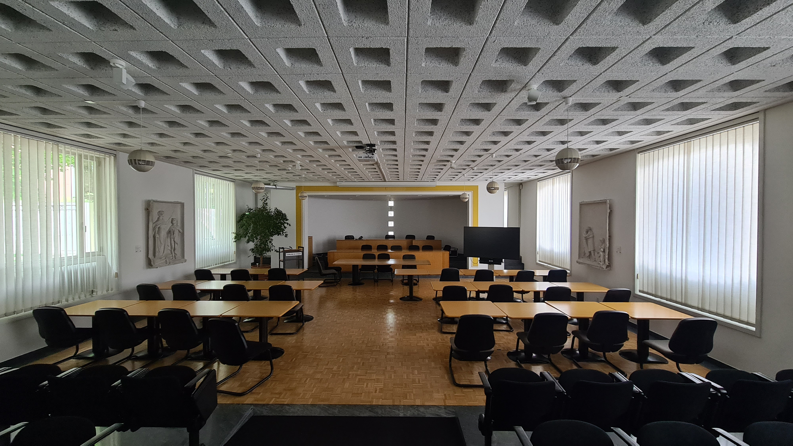
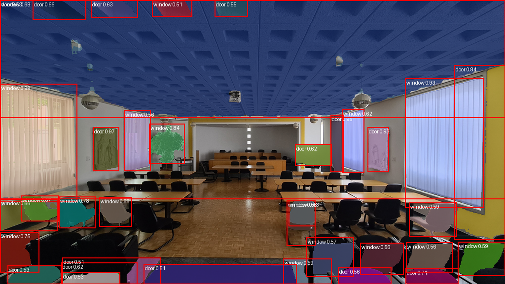

# TRACEABLE

Analyses an image and recognises which component each region is. The current
public pipeline does not train or fine-tune a model on the supplied image or
component labels.

## Current AI example: doors and windows

This example uses `Images/20260504_103344.jpg`. The current run offers the AI
only two labels, `door` and `window`, and saves its annotations to
`output/20260504_103344.png`.

| Input image | AI output (upscaled preview) |
| --- | --- |
|  |  |

The output preview is enlarged to the input image's 4000 × 2252 dimensions for
display; recognition itself runs on a resized 1024 × 577 image.

SAM proposes image regions and CLIP assigns each region one of the supplied
labels. In this example it finds some windows and doors, but also labels parts
of the ceiling, walls, and furniture as doors or windows. Restricting the
labels limits what names can appear; it does **not** ensure that only real
doors and windows are marked. The current pipeline has no “neither” option to
reject unrelated regions, so these results are illustrative and need human
review rather than being treated as reliable detections.

## What the code does

The default `ComponentRecognizer` pipeline is:

1. It converts the input image to RGB.
2. **Segment Anything (SAM)** generates candidate masks automatically. The
   default model is `facebook/sam-vit-base`, which is the **SAM ViT-B
   (Vision Transformer Base)** model. The Transformers mask-generation
   pipeline prompts SAM over an image-point grid; no user-drawn boxes or
   points are required.
3. Masks smaller than `min_area` are discarded (the default is 500 pixels).
   For every remaining mask, the code crops its bounding box and replaces
   pixels outside the mask with white.
4. **CLIP** compares each masked crop with text prompts made from the labels:
   `a photo of a {label}`. The default model is
   `openai/clip-vit-base-patch32`, a **CLIP ViT-B/32** image-and-text model.
   The label with the highest image-text similarity is selected. The
   similarities are converted to a softmax score; the CLI keeps detections
   with a score of at least 0.3 by default.
5. The detections are sorted by descending score and returned as a label,
   score, bounding box, area, and mask. The JSON CLI output omits the mask;
   `--out` writes the original image with coloured masks, red boxes, and
   labels overlaid.

This is zero-shot recognition: the component names supplied by the user are
candidate text labels, not training examples. The code does not claim that a
detected component is present with calibrated probability, and it does not
fine-tune either model for circuit boards or electronic components.

## Models and pretrained weights

Both default models are loaded with `from_pretrained` through Hugging Face
Transformers. Their weights and processors are downloaded and cached on the
first run; they are not trained by this project.

### SAM ViT-B

- Model ID: `facebook/sam-vit-base`
- Architecture: SAM with a ViT-B image encoder, plus SAM's prompt encoder and
  mask decoder.
- Pretraining: the Segment Anything model was trained using the **SA-1B
  dataset**, consisting of approximately **11 million licensed, privacy-
  respecting images and 1.1 billion masks**.
- In this project it is used for automatic, zero-shot mask generation, not for
  component classification.

### CLIP ViT-B/32

- Model ID: `openai/clip-vit-base-patch32`
- Architecture: a ViT-B/32 image encoder and a Transformer text encoder.
- Pretraining: OpenAI trained CLIP with contrastive learning on publicly
  available image-caption data collected from the internet and existing
  datasets, including YFCC100M. The original CLIP release describes the
  training set as approximately **400 million image-text pairs** (often called
  WebImageText); the complete dataset was not released.
- In this project it is used without fine-tuning to rank the supplied English
  component names.

The repository also contains `models/sam_vit_b.pth`, but the current
`ComponentRecognizer` does **not** load that file. It uses the Hugging Face
model ID above. The lower-level `SamSegmenter` class can load a checkpoint
path explicitly, but that class is not used by the default CLI or the public
`ComponentRecognizer` pipeline.

## Run the included images

Run `python main.py` to process every supported image in `Images/`. Each
annotated result is saved to `output/` using the input image's filename and a
`.png` extension. Pass an image path to process only that image; it uses the
same filename-based output naming.

```
pip install -e .
tracebale board.jpg --labels "resistor,capacitor,microchip,connector" --out annotated.png
```

Output is JSON (label, score, box, area per segment); `--out` saves an annotated image.
Use `--sam-model` and `--clip-model` to select different compatible Hugging Face
models.

Python:
```python
from PIL import Image
from tracebale import ComponentRecognizer
rec = ComponentRecognizer(["resistor", "capacitor"])
dets = rec.recognize(Image.open("board.jpg"))
```

Tests: `pip install pytest numpy pillow && pytest` (pure-logic tests need no models).

## Qwen-VL / vLLM analysis

`../vLLM.py` sends the photographs in `Images/` to an OpenAI-compatible local
vLLM server running `Qwen/Qwen3-VL-32B-Instruct`. The server must be running
before the batch script is started. By default the script uses:

- API endpoint: `http://localhost:8000/v1`
- Input directory: `tracebale/Images/`
- JSON output directory: `tracebale/vllm_output/`
- Maximum image side: 1568 pixels
- Maximum response length: 4000 tokens
- Request timeout: 300 seconds

Install the client-side dependencies in the project virtual environment:

```bash
source .venv/bin/activate
python -m pip install openai requests pillow-heif
```

Run the complete batch from the project parent directory:

```bash
python vLLM.py
```

The script performs an endpoint health check, normalizes EXIF orientation,
resizes images, encodes them as JPEG data URIs, and writes one JSON report per
image. It does not silently retry a timed-out model request.

### vLLM configuration and resume controls

The batch can be configured with environment variables:

| Variable | Default | Purpose |
| --- | --- | --- |
| `OPENAI_BASE_URL` | `http://localhost:8000/v1` | OpenAI-compatible vLLM endpoint |
| `OPENAI_API_KEY` | `token-not-needed` | API key passed to the client |
| `OPENAI_MODEL` | `Qwen/Qwen3-VL-32B-Instruct` | Model name |
| `MAX_IMAGE_SIDE` | `1568` | Maximum encoded image dimension |
| `OPENAI_MAX_TOKENS` | `4000` | Maximum generated response tokens |
| `OPENAI_REQUEST_TIMEOUT` | `300` | Per-image request timeout in seconds |
| `OPENAI_SKIP_EXISTING` | `1` | Reuse valid existing JSON reports |
| `OPENAI_START_INDEX` | `1` | One-based image index at which to start |
| `OPENAI_SKIP_ENDPOINT_CHECK` | `0` | Skip the initial `/models` health check |

For example, to rerun image 9 and all following images, even when JSON
outputs already exist:

```bash
OPENAI_START_INDEX=9 OPENAI_SKIP_EXISTING=0 python vLLM.py
```

The image order is the case-insensitive sorted order of supported files in
`Images/`. A timeout prints `API_ERROR: Request timed out.` and stops the
batch without overwriting the existing report for that image.

## SUPSI knowledge-base export

`supsi_kb.py` reads the JSON reports produced by `vLLM.py`, evaluates their
components against the SUPSI WBS, RSL, and anomaly catalogs, and exports an
inventory workbook. The exporter writes the `Inventory` worksheet to
`TRACEABLE_Inventory_AI_Generated.xlsx` by default.

From the project parent directory (the directory containing `supsi_kb.py`),
install the Excel-processing dependencies in the project virtual environment:

```bash
source .venv/bin/activate
python -m pip install pandas openpyxl
```

Run the knowledge-base export from that same directory:

```bash
python supsi_kb.py \
  --vllm-dir tracebale/vllm_output \
  --export-excel TRACEABLE_Inventory_AI_Generated.xlsx
```

Useful options:

- `--vllm-dir PATH` — directory containing vLLM JSON reports.
- `--export-excel PATH` — destination `.xlsx` file; defaults to
  `TRACEABLE_Inventory_AI_Generated.xlsx`.
- `--rebuild-db` — rebuild the local `supsi_kb.sqlite` catalog database.

Existing valid JSON reports can be reused without rerunning the vLLM inference
step.

## Optional active 3D metric-depth measurements

`supsi_kb_2.py` adds an optional single-image 3D measurement step. When both
`--image-dir` and `--depth-weights` are supplied, it:

1. Matches each vLLM JSON report to the RGB image with the same filename stem.
2. Converts each vLLM bounding box from normalized `[ymin, xmin, ymax, xmax]`
   coordinates into image pixels.
3. Runs the Depth Anything V2 **metric-depth** model to estimate depth in
   meters.
4. Back-projects the depth pixels into a 3D point cloud.
5. Fits an Open3D oriented bounding box and reports estimated width, height,
   thickness, area, and median distance.

The resulting metric dimensions take precedence over the VLM's rough
`geometry_estimate` text and are written to the Excel `Geometry` column with
the suffix `measured via Metric Depth`. This is an RGB single-view estimate,
not a laser scan or certified survey measurement. Accuracy depends on the
depth checkpoint, bounding-box quality, camera metadata, scene visibility, and
the fallback 65-degree field-of-view assumption when focal-length EXIF data is
unavailable.

The metric path requires Open3D, PyTorch, NumPy, the Depth Anything V2 Python
module on `PYTHONPATH`, and a compatible metric checkpoint (the default model
configuration is ViT-L with a 20 m indoor maximum depth):

```bash
python -m pip install open3d torch numpy
export PYTHONPATH="/path/to/Depth-Anything-V2:$PYTHONPATH"
```

Run the extended export from the project parent directory:

```bash
python supsi_kb_2.py \
  --vllm-dir tracebale/vllm_output \
  --image-dir tracebale/Images \
  --depth-weights /path/to/depth_anything_v2_metric_hypersim_vitl.pth \
  --export-excel TRACEABLE_Inventory_MetricDepth.xlsx
```

Without both `--image-dir` and a valid `--depth-weights` path,
`supsi_kb_2.py` continues using the VLM-provided geometry estimate. Individual
metric-depth failures are reported and do not prevent the remaining reports
from being exported.
